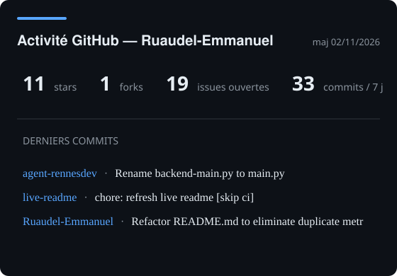

# 📊 live-readme — README vivant

> Carte d'activité GitHub générée automatiquement chaque matin : stars, forks, issues ouvertes,
> commits des 7 derniers jours et derniers commits — **0 LLM, 0 token, 0 €**.



## ⚙️ Comment ça marche

| Élément | Rôle |
|---|---|
| `.github/workflows/live-readme.yml` | cron quotidien à 07h17 (Paris) + déclenchement manuel |
| `scripts/generate_activity_svg.py` | Python stdlib — ~7 requêtes API GitHub, aucune dépendance |
| `assets/github-activity.svg` | la carte, commitée uniquement si son contenu change |

Le workflow tourne gratuitement (runner public), sans secret à configurer : le
`GITHUB_TOKEN` automatique suffit. Si rien n'a changé depuis la veille, aucun commit
n'est créé — l'historique reste propre.

## 🔗 Réutiliser la carte ailleurs

Le SVG est référençable depuis n'importe quel README :

```text

```

## 🎨 Personnalisation

Tout se règle en tête de `scripts/generate_activity_svg.py` : couleurs (`fg`, `accent`, `bg`),
nombre de repos suivis (`[:3]`), fenêtre de commits (`days=7`), taille du SVG.
